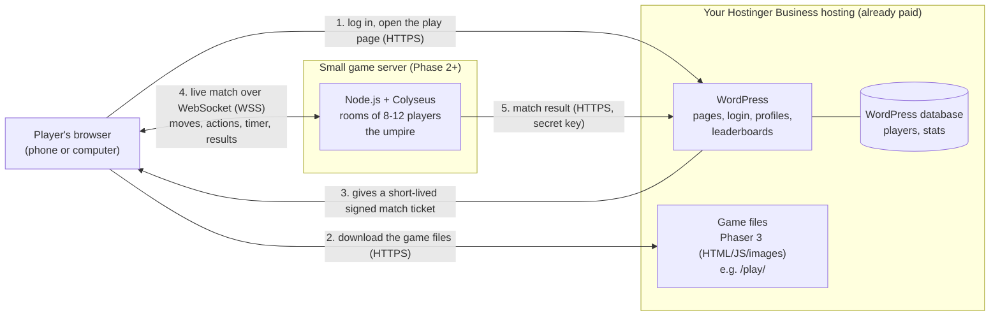

# Sams Gama: architecture, deployment and costs

Checked 28 Oct 2026. Prices change often, so check them again before you buy anything.

## 1. The three parts, in plain language

| Part | What it is | What it does | Where it runs |
|---|---|---|---|
| **WordPress website** | Your existing site | Pages, rules, sign-up and login, profiles, leaderboards, later payments | Your current Hostinger Business hosting (no change) |
| **Browser game** | Phaser 3 files (HTML, CSS, JavaScript, images) | Draws the village, reads the keyboard or touch controls, shows what the server says | Static files, so they can be served by your Hostinger hosting |
| **Game server** | Node.js + Colyseus | Runs each 15-minute match: positions, roles, theft, kills, votes, money, timer, who wins | A small separate server that allows always-on WebSocket connections (only from Phase 2) |

You can think of it like a cricket match: **WordPress** is the ticket office and the scoreboard. The **browser game** is
each player's own view of the ground. The **game server** is the umpire. Players can ask for things ("I want to steal this
paddy"), but only the umpire decides what really happens, so nobody can cheat by changing the game in their browser.

## 2. What your hosting can and cannot do

From Hostinger's own help pages:

- Business web hosting can run **Node.js web apps** (Business allows 5 Node.js sites, sharing one memory and process pool).
- But Web and Cloud hosting plans **only allow outgoing WebSocket connections, not incoming ones**. A multiplayer game
  server needs incoming connections from every player, so it **cannot run on your Business plan**.
- Requests are stopped after **120 seconds**, and **always-running background workers are not supported**. A match lasts
  15 minutes and must keep running between player messages, so this also rules it out.
- Hostinger points apps that need incoming connections to a **VPS**.
- Cloud hosting has the same WebSocket limit, so upgrading to Cloud would not help. As you asked, it is not recommended.

So: **WordPress and the game files stay on your current hosting. Only the live game server needs somewhere else, and only
from Phase 2.**

Sources: [Hostinger: web standards and connectivity](https://www.hostinger.com/support/which-web-standards-and-connectivity-features-are-supported-at-hostinger/),
[Hostinger: Node.js hosting options](https://www.hostinger.com/support/1583661-is-node-js-supported-at-hostinger/),
[Hostinger: Are sockets supported?](https://www.hostinger.com/support/?p=1364),
[Hostinger: adding a Node.js web app](https://www.hostinger.com/support/how-to-deploy-a-nodejs-website-in-hostinger).

## 3. Safe login between WordPress and the game server (Phase 5)

The goal: the game server knows **which WordPress player** is connecting, without ever seeing a password, and the browser
never holds a secret that could be misused.

1. The player logs in to WordPress as usual (one account system, the existing WordPress users).
2. On the **Play** page, WordPress (a small plugin we will write) creates a **match ticket**: the player's user ID,
   display name, an expiry time of about 60 seconds, and a random one-time number. WordPress **signs** it with a secret key
   that lives only in `wp-config.php` and on the game server, never in browser code.
3. The browser passes this ticket to the game server when it joins a room.
4. The game server checks the signature, the expiry and that the one-time number has not been used. If anything is
   wrong, the player is refused. Colyseus has an `onAuth` step made for exactly this.
5. At the end of a match, the game server sends the result to a WordPress REST endpoint, signed with a **second** secret
   key. WordPress saves the stats and updates the leaderboard.

The ticket is useless a minute later and cannot be changed without breaking the signature, so it is safe even if someone
copies it. Passwords never leave WordPress.

## 4. Anti-cheat rule (applies from Phase 2)

The browser only sends **requests** ("move left", "steal from Ruwan's basket", "vote for Kamala"). The server checks every
request (is it night? are you close enough? are you a thief? have you already killed tonight?) and only then changes the
game. Roles are sent only to the player they belong to, so nobody can read the other roles from the network traffic.
In this Phase 1 prototype everything still runs in the browser, which is fine for testing the map but not for real
matches. The code marks these places with `PROTOTYPE`.

## 5. Deployment plan

| Stage | What goes where | Extra cost |
|---|---|---|
| **Phase 1 (now)** | Everything on your computer (`npm start`, http://localhost:8080) | Free |
| **Phase 1 demo online (optional)** | Upload the `client` folder to your site, e.g. `public_html/play/`, with Hostinger File Manager or FTP. It is just static files, which Business hosting serves fine. | Free |
| **Phase 2-3 testing** | Game server on your computer first (several browser tabs = several players). For tests with friends: a free host for a few days (see below). | Free |
| **Phase 5-6 launch** | Game files on Hostinger (`/play/`), WordPress plugin on Hostinger, game server on a small VPS at a subdomain such as `play-server.yourdomain` (a subdomain of your current domain is free). | VPS monthly fee |

No new domain is needed. The game server gets a subdomain of your current domain, with a free Let's Encrypt
certificate so it can use secure WebSockets (`wss://`).

### Free options for early multiplayer tests (not for real players)

| Option | Good for | Limits |
|---|---|---|
| **Your own computer** | All development and tests with several browser tabs | Only you, unless you open a tunnel |
| **Render free web service** | Short online tests with friends | Sleeps after 15 minutes without traffic and takes about 1 minute to wake up. Can restart at any time, which ends running matches. 750 free hours a month. Files are wiped on restart. |
| **Oracle Cloud "Always Free"** | A real free VPS | Signup needs a card, free capacity is often unavailable in popular regions, and the account can be reclaimed if idle. More setup work. |

None of these is suitable for production: a restart in the middle of a 15-minute match would ruin it for 8-12 people.

## 6. Costs

### Development (Phases 1-4)

| Item | One-time | Monthly |
|---|---|---|
| Node.js, VS Code, Git, Chrome | Free | Free |
| Phaser 3, Colyseus | Free (open source) | Free |
| Hostinger Business hosting | Already paid | Already paid |
| Domain | Already owned | n/a |
| **Total** | **0** | **0** |

### Testing with friends (Phase 2-6)

Free with your computer or Render free, or about the price of one month of a VPS if you want reliable tests.

### Production (after Phase 6, only when the game is ready)

One small VPS (1-2 virtual CPUs, 2-4 GB memory) can run many 8-12-player rooms at once. A social deduction game sends
very little data.

| Provider and plan | Approx. price | Notes |
|---|---|---|
| **Hostinger KVM 1** (1 CPU, 4 GB) | about USD 6.49/month on a 24-month promo, **renews at about USD 11.99/month** | Same company and control panel you already use. Pay attention to the renewal price. |
| **Hetzner Cloud CX23** (2 CPU, 4 GB) | about EUR 4-5.50/month incl. IPv4, before VAT, billed hourly, no long contract | Cheapest reliable option. Price rose in 2026, and some CX plans may not be orderable, so check. EU/US data centres, so slightly more delay from Sri Lanka (still fine for this type of game). |

Rough yearly cost for production: **about USD 60-145 a year**, depending on the provider and promotion. Nothing else is
required. Optional later: a paid uptime monitor (free tiers exist) and backups (Hetzner +20 %).

What we will **not** buy: Hostinger Cloud hosting, a second domain, paid game engines, paid plugins, Colyseus Cloud
(managed hosting, more expensive than a VPS).

Price sources (third-party, Oct 2026): [Hostinger VPS pricing explained](https://hostadvice.com/hosting-company/hostinger-reviews/vps-pricing/),
[Hostinger renewal prices](https://findstack.com/resources/hostinger-renewal-price),
[Hetzner CX23 benchmark and price](https://www.vpsbenchmarks.com/hosters/hetzner/plans/cx23),
[Hetzner 2026 price increase](https://findstack.com/resources/hetzner-price-increase-2026),
[Render free tier](https://render.com/docs/free).

## 7. Phase plan (where we are)

- [x] **Phase 1, local prototype:** village map, movement and collision, interactive places, day/night clock, phone controls.
  Also built during Phase 1 (owner's requests, 28 Oct 2026): own colours and houses, gardens with owner payments, food,
  boats, water rescue, dusk/sleep, elephants that kill at night, trading and wealth ranking, stealing that names ordinary
  villagers, village map. All of this runs in the browser for now; Phase 2-3 moves the decisions to the server.
- [x] **Phase 2, multiplayer foundation (10 Nov 2026):** Colyseus 0.16 server in `server/` (serves the game too, port 2567).
  Tested with two browser tabs: different colours and houses, movement synced, same clock (N skips for everyone),
  night silhouettes for the other player, teleport refused, dropped connection reconnects with the same seat,
  leaving frees the house. Still per browser (Phase 3): money, goods, elephants, stealing, trading, rescues.
- [x] **Phase 3, core game (10 Nov 2026):** lobby with host Start, secret roles dealt by the server (thief, police,
  doctor, villager; only sent to their owner, thieves learn partners), night kills at a person or their door (one per
  thief per night, Rs 100 loot), doctor's guard, police questions, stealing names ordinary villagers (server flag),
  elephant deaths reported by the browser and checked (night, outside), morning news, village bell (once per player per
  match), 75-second meetings and votes, final vote, win conditions, end screen with all roles, New match. Robot test
  (28 checks) and browser test passed. Free friends test over a Cloudflare quick tunnel (`play-online.ps1`).
- [ ] **Phase 4, village economy:** buying and selling, crops, livestock, fishing, storage, elephant raids at night.
- [ ] **Phase 5, website:** WordPress plugin (Play page, match tickets, results, leaderboard), deploy game files and server.
- [ ] **Phase 6, testing and launch:** 8-12 real players, cheating checks, reconnects, phone performance.

Game rules decided by the owner (28 Oct 2026), to enforce on the server in Phase 3: original thieves get money by
killing (they take the victim's money); an ordinary villager who steals is named to everyone; villagers who are outside
at night can be killed by elephants; everyone must eat every day; other players' money is never sent to the browser
(only the ranking).

Ideas from the concept art to fit into Phases 3-4: catching a thief and taking them to the village square or the police;
tools from the workshop and shop (sickle, water pot, seed bag, basket, axe, fishing rod, milk bucket, torch, food);
villagers can steal at night when they have no cash but must bring stolen goods back; win by filling the village store and
completing tasks, or by removing all original thieves. The role costumes in the character sheet (police cap, doctor coat,
thief mask, ghost) suit role-reveal cards and the end-of-match screen, while everyone looks like an ordinary villager in
the village itself.
